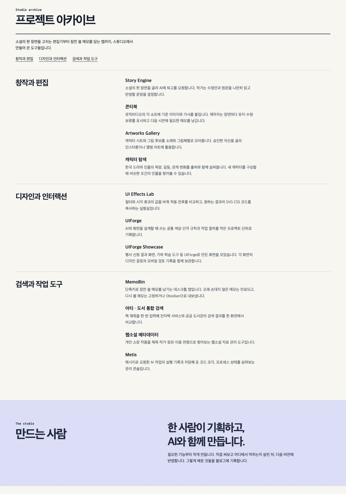
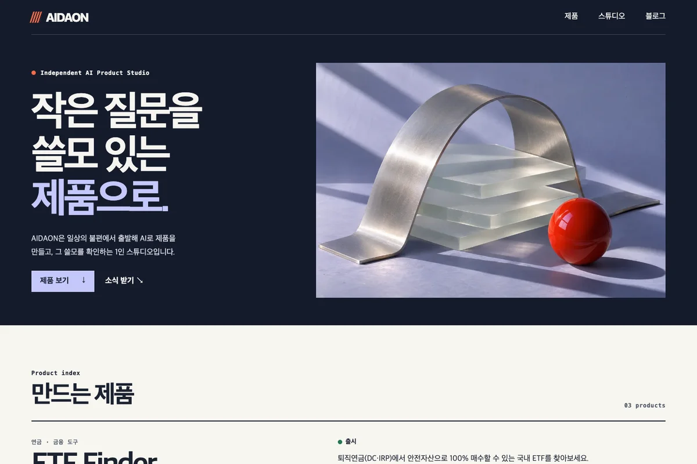
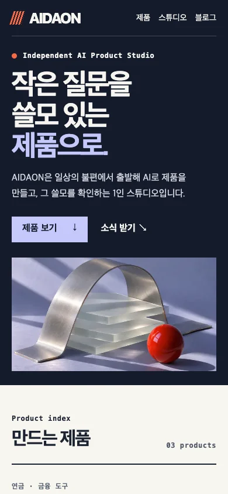
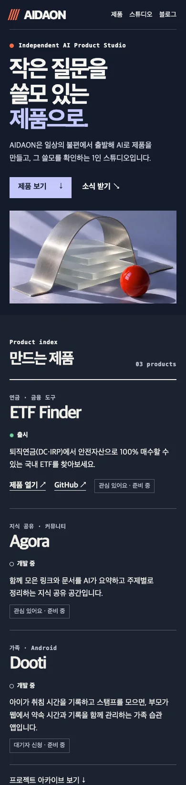

개인 프로젝트가 늘어나니 GitHub 프로필 하나로는 무엇을 만드는 사람인지 설명하기 어려워졌다. 공개한 도구도 있고, 아직 개발 중인 앱도 있고, 매일 쓰지만 저장소는 비공개인 작업도 있었다. 각각의 주소를 전달하는 대신 한곳에서 소개할 대표 사이트가 필요했다.

그래서 **AIDAON이라는 1인 제품 스튜디오 홈페이지**를 만들었다. 도메인이 404를 보여 주던 상태에서 시작해, 제품과 작업 기록을 묶는 사이트로 정리한 과정이다. 화면을 만드는 일만큼이나 어떤 프로젝트를 어떤 말로 소개할지 결정하는 데 시간이 들었다.

> **AI 활용 및 화면 기준 안내**
>
> 이 글은 AI 에이전트와 함께 진행한 제작 기록과 코드를 바탕으로 작성했다. 아래 캡처는 **2026년 11월 24일 KST의 로컬 미리보기 시안**이다. 첫 화면의 추상 정물은 AI로 생성한 이미지이며, 제품의 실제 사용 화면이 아니다. 캡처 이후 구현이 바뀌어 현재 공개 사이트와 모양이 다를 수 있다.

## 도메인 연결과 첫 페이지 배포는 별개였다

시작할 때 도메인은 이미 GitHub Pages를 가리키고 있었지만 브라우저에서는 404가 나왔다. 주소를 연결했다고 방문자가 읽을 첫 페이지까지 생기는 것은 아니었다.

처음부터 모든 제품 소개를 완성하려고 기다리지 않고 임시 첫 페이지를 먼저 배포했다. 그다음 도메인으로 페이지가 열리는지, HTTPS로 접속되는지 확인했다. 이 순서 덕분에 주소와 배포 연결 문제를 먼저 확인하고 본문과 화면 작업을 이어갈 수 있었다.

**준비 중 페이지가 열리는 것과 완성 화면을 공개한 것은 다른 단계**다. 제공받은 캡처를 만들 당시의 인계 기록에는 공개 도메인이 준비 중 페이지였다고 적혀 있었다. 이후 이 글을 작성하며 다시 확인한 2026년 11월 24일에는 [공개 홈페이지](https://aidaon.com/)에서 제품과 아카이브가 표시됐다. 이 글의 게시 작업에서 홈페이지 자체를 수정하거나 배포하지는 않았다.

GitHub Pages에 Astro 사이트를 올리는 설정은 [Astro 공식 배포 안내](https://docs.astro.build/en/guides/deploy/github/)를 참고할 수 있다. 자체 도메인을 쓸 때는 사이트의 기준 주소를 나타내는 `site` 설정도 실제 공개 주소에 맞춰야 한다. 도메인 설정과 빌드·배포 흐름을 함께 확인하는 것이 첫 단계였다.

## 소개 페이지에 필요한 만큼 Astro를 썼다

이번 홈페이지에는 **Astro 7.4.13의 정적 출력**을 사용했다. 정적 출력은 빌드할 때 HTML을 미리 만들고, 방문자에게 그 파일을 전달하는 방식이다. 제품 소개와 링크 중심인 사이트에 맞는 선택이었다.

구조는 크게 세 부분으로 나눴다.

| 역할 | 이번 구현 | 바꿀 때의 기준 |
|---|---|---|
| 제품 정보 | `src/data/products.ts` | 이름, 상태, 설명, 공개 링크를 한곳에서 관리 |
| 반복되는 화면 | `ProductEntry.astro` 등 Astro 컴포넌트 | 제품마다 같은 표시 규칙 적용 |
| 전체 문서 | 페이지와 공통 레이아웃 | 제목, 설명, 공유 정보와 페이지 구성 관리 |

제품 정보에는 이름뿐 아니라 **출시·개발 중 같은 상태와 공개할 수 있는 링크**를 담았다. 아직 신청 창구가 없는 제품은 준비 중으로 표시했다. 방문자가 설명을 읽고 눌렀을 때 실제로 할 수 있는 행동이 무엇인지 구분하기 위해서다.

블로그 최신 글도 홈페이지에 연결했다. RSS는 글 제목과 주소를 전달하는 목록 형식인데, 이번에는 **빌드 시점에 블로그 RSS를 읽어 최신 글 링크를 HTML에 넣는 방식**을 사용했다. 방문할 때마다 새로 불러오는 구조는 아니므로 새 글이 홈페이지에 반영되려면 홈페이지를 다시 빌드해야 한다. RSS를 읽지 못할 때는 블로그 목록으로 안내하도록 대체 링크도 두었다.

검색엔진에 페이지 목록을 알리는 **사이트맵**과, 메신저 등에서 주소를 공유할 때 쓰이는 **OG 이미지**도 추가했다. 화면을 다 만든 뒤 주소만 붙이는 대신, 공개 주소와 제목·설명·공유 이미지가 맞는지 함께 보는 작업이었다. 이 구성의 코드는 [AIDAON 공개 저장소](https://github.com/antdailycraft/aidaon)에서 확인할 수 있다. 저장소의 최신 화면은 이 글의 초기 시안 캡처와 다를 수 있다.

## 공개 저장소 목록만으로는 작업이 설명되지 않았다

처음에는 공개 저장소를 모으면 제품 목록이 될 것 같았다. 하지만 그렇게 세면 비공개로 진행하던 작업이 빠졌다. 반대로 저장소가 있다는 이유만으로 모두 방문자가 바로 사용할 수 있는 제품처럼 소개할 수도 없었다.

등록된 프로젝트 목록과 실제 작업 내용을 대조하면서, 외부에 설명할 수 있는 범위를 다시 정리했다. 내부 주소와 운영 정보는 빼고 **누구의 어떤 일을 돕는지**를 짧게 쓰는 데 집중했다.

홈페이지에는 만드는 제품, 공개 도구, 프로젝트 아카이브를 두었다. 제품은 현재 상태와 사용할 수 있는 링크가 중요했고, 아카이브는 작업의 성격을 이해할 수 있는 설명이 중요했다. 모든 항목에 링크를 억지로 붙이기보다 공개 가능한 설명부터 남겼다.

<figure>
  
  <figcaption>2026-11-24 로컬 데스크톱 미리보기에서 아카이브 영역을 발췌했다. 저장소 이름의 나열보다 작업의 목적을 설명하는 데 초점을 맞췄다.</figcaption>
</figure>

예를 들어 창작 도구는 작가가 무엇을 고르고 확인하는지, 메모 도구는 메모를 남긴 뒤 어떻게 다시 쓰는지를 설명했다. 프로젝트를 정리하는 과정이 곧 홈페이지에 들어갈 문장을 다듬는 과정이었다.

## 첫 화면은 보기 좋았지만 제품 설명은 부족했다

첫 시안은 큰 제목과 추상 정물 이미지로 시작했다. 금속 아치와 유리 계단, 붉은 구체를 조합한 AI 생성 이미지였다. 차분한 배경과 또렷한 강조색을 만들기에는 쓸 수 있었지만, 어떤 제품을 만드는 곳인지 직접 보여 주지는 못했다.

<figure>
  
  <figcaption>2026-11-24 로컬 첫 화면 시안. 오른쪽 정물은 AI로 생성했으며 실제 제품이나 서비스 화면을 나타내지 않는다.</figcaption>
</figure>

피드백에서도 **무엇을 만드는지 전달하기 어렵다**는 지적이 나왔다. 제품 화면으로 바꾸는 안은 이 캡처 시점에는 제안 단계였다. 시안이 깔끔하다는 것과 방문자가 제품을 이해한다는 것은 별도로 확인해야 했다.

글 작성 중 다시 확인한 공개 화면에는 추상 정물 대신 제품 바로가기 타일이 표시됐다. 이 변화는 캡처 이후 상태이며, 아래 이미지를 현재 공개 화면의 증거로 제시하지는 않는다. 초기 시안과 피드백을 함께 남기는 이유는 첫 화면의 역할을 다시 생각하게 만든 지점이기 때문이다.

## 모바일과 키보드에서 다음 행동이 이어지는지 봤다

데스크톱에서 제목과 이미지를 나란히 놓았더라도 모바일에서는 같은 배치를 유지하기 어려웠다. 좁은 화면에서는 **소개, 행동 링크, 이미지, 제품 설명을 한 열로 읽도록** 정리했다.

<figure>
  
  <figcaption>2026-11-24 로컬 모바일 첫 화면. 작은 화면에서 소개와 행동 링크를 먼저 읽도록 배치한 시안이다.</figcaption>
</figure>

‘제품 보기’처럼 다음 행동을 알려 주는 문구를 두고, 마우스 없이도 링크를 따라갈 수 있는지 확인했다. 코드에는 본문으로 바로 이동하는 링크와 키보드 초점 표시를 넣었다. 초점 표시는 Tab 키로 이동할 때 지금 선택된 링크의 위치를 알려 주는 테두리다. 캡처만으로 키보드 동작을 증명할 수는 없으므로 화면 확인과 동선 확인은 따로 진행했다.

다크모드에서는 배경만 어둡게 만드는 것으로 끝내지 않고 설명과 구분선이 읽히는지도 살폈다. 이번 구현은 운영체제의 밝은 화면·어두운 화면 설정을 따르는 방식이다.

<figure>
  
  <figcaption>2026-11-24 로컬 모바일 다크모드 캡처의 상단 발췌. 출시 상태와 준비 중 표시도 함께 확인했다.</figcaption>
</figure>

## 점수와 공개 상태는 따로 기록했다

제작 당시 로컬 빌드를 대상으로 측정한 모바일 Lighthouse 결과는 **성능 100, 접근성 100, SEO 100**이었다. Lighthouse는 브라우저에서 페이지 품질을 자동 점검하는 도구이고, SEO는 검색엔진이 페이지 정보를 이해할 수 있는지를 살피는 항목이다.

이 수치는 **그때의 로컬 빌드 측정치**다. 현재 공개 홈페이지를 새로 측정한 점수도 아니고, 이 블로그 글의 점수도 아니다. 자동 검사에서 높은 점수를 얻어도 소개 문장의 이해도나 실제 사용자의 모든 접근성 요구까지 확인한 것은 아니다. 추상 이미지에 대한 피드백이 바로 그런 차이를 보여 줬다.

이번에 배운 순서는 명확했다. 먼저 도메인과 HTTPS에서 첫 페이지가 열리는지 확인하고, 실제 작업 목록을 대조해 공개할 설명을 고른 다음, 방문자가 제품을 이해하고 다음 행동으로 이동할 수 있는지 보는 것이다. 다음 검토에서는 첫 화면을 본 사람이 어떤 제품을 만드는 곳인지 설명할 수 있는지를 확인하려 한다. 그 결과로 첫 화면 문구와 제품 소개 순서를 다시 다듬을 수 있다.

## 확인한 자료와 범위

- [Astro의 GitHub Pages 배포 안내](https://docs.astro.build/en/guides/deploy/github/): 빌드·배포 및 공개 주소 설정 참고.
- [AIDAON 공개 저장소](https://github.com/antdailycraft/aidaon): 공개된 구현 참고. 글의 캡처 이후 변경이 포함될 수 있다.
- [AIDAON 홈페이지](https://aidaon.com/): 2026-11-24 글 작성 중 HTTPS 접속과 제품·아카이브 표시 확인.
- 제작 인계 기록과 제공된 로컬 미리보기 캡처: 404에서 첫 배포까지의 경과, 초기 시안과 피드백, 당시 Lighthouse 측정 결과의 근거. 이번 글 작성에서 과거 점수를 재측정하지는 않았다.

**2026-11-24 최초 작성.** 캡처 당시의 시안, 이후 확인한 공개 화면, 앞으로 검토할 항목을 구분해 기록했다.
